# Simple Auction DApp

A single-item auction DApp made for Blockchain Technology (CSE4444), Assignment 2. It uses Solidity for bidding and handling test ETH, and a basic HTML/CSS/JavaScript page connected to MetaMask through Ethers.js.

## 1. Problem addressed by the DApp

In an ordinary online auction, the platform manages bids and payments. Here, the smart contract holds the ETH and applies the bidding and refund rules. The seller cannot collect the winning bid until the auction closes, and an outbid participant can withdraw their own refund without relying on the seller.

The contract records the highest bid and bidder, rejects invalid transactions, and prevents repeated withdrawals. It supports **one auction per deployment**. The seller ends bidding manually; physical delivery of the item is outside the DApp.

The main contract functions are `placeBid()`, `withdrawRefund()`, `endAuction()`, and `withdrawProceeds()`. The constructor sets the seller, item name, and starting price. Public getters provide auction details to the frontend. The source is in [`auction.sol`](auction.sol).

## 2. Steps to execute the application

**Tools:** Remix IDE, Ganache Desktop, MetaMask, VS Code with Live Server, and a browser. The frontend uses Ethers.js v6, loaded from a CDN in `index.html`.

### Deploy the contract

1. Start **Ganache Desktop** and note its RPC URL and chain ID.
2. Open [`auction.sol`](auction.sol) in **Remix IDE** and compile with Solidity 0.8.20 or a later 0.8.x compiler. For the demonstrated setup, select the **London EVM version** for Ganache compatibility.
3. In **Deploy & Run Transactions**, select **Custom – External HTTP Provider**, enter Ganache's RPC URL, and choose a funded Ganache account as the seller.
4. Deploy `Auction` with an item name (e.g., `Football Jersey`) and a starting price of `1` (whole ETH). Set Remix's transaction **Value to 0 ETH** for deployment.
5. Copy the new contract address into `contractAddress` in [`app.js`](app.js). Update `GANACHE_CHAIN_ID` there if your network uses a different chain ID.

### Connect MetaMask and use the DApp

1. In MetaMask, add a custom network with Ganache's RPC URL and chain ID. Import **only Ganache's disposable development accounts** for the seller and bidders. Do not put private keys or recovery phrases in this repository.
2. Run `index.html` using **VS Code Live Server**. Click **Connect MetaMask**, approve access, and click **Refresh Details** to read the contract's state.
3. Switch to a bidder account, enter an amount in ETH, and click **Place Bid**. Confirm the transaction in MetaMask. A higher bid replaces the previous leader.
4. When outbid, switch back to that bidder's wallet and click **Withdraw Refund**. The seller can use **End Auction** followed by **Withdraw Proceeds**. The page reads updated values after successful transactions.

*Note:* Ganache is local to the computer. The deployment shown in the screenshots has already closed and settled. To run a new auction, deploy a new contract and update its address in `app.js`.

## 3. Deployment network and contract address

| Setting | Demonstrated value |
|---|---|
| Network | Ganache local Ethereum network |
| RPC URL | `http://127.0.0.1:7545` |
| Chain ID | `1337` |
| Contract | `Auction` |
| Deployed address | `0x50F3a788E790C2f7Dd61f1862B58Ed316709CFBb` |
| Auction item | Football Jersey |
| Starting price | 1 test ETH |

This is a **local Ganache address**, not a public Mainnet or Sepolia deployment.

## 4. Test cases and observed results

The contract was tested directly in **Remix VM** for readable revert reasons. The complete auction workflow was also tested with **Ganache, MetaMask, and the frontend**.

### Valid operations

| Test | Expected result | Observed result |
|---|---|---|
| Alice bids 2 ETH | Alice becomes highest bidder | Passed — Alice recorded at 2 ETH |
| Bob bids 3 ETH | Bob takes the lead; Alice becomes eligible for a refund | Passed — Bob at 3 ETH; Alice refund 2 ETH |
| Alice withdraws refund | 2 ETH returned; refund balance reset | Passed |
| Seller ends auction | Status changes to Closed | Passed |
| Seller withdraws proceeds | Seller receives winning 3 ETH | Passed |

### Invalid operations

| Test | Expected result | Observed result |
|---|---|---|
| Bid below starting price | Reject bid | `Below starting bid` |
| Bid after closure | Reject bid | `Auction has ended` |
| Withdraw seller proceeds twice | Reject second withdrawal | `Already withdrawn` |
| Withdraw the same refund twice | Reject second withdrawal | `No refund available` |

### Unauthorised operation

| Test | Expected result | Observed result |
|---|---|---|
| Non-seller tries to close the auction | Reject caller | `Only seller can end auction` |

The screenshots showing the full revert reasons were taken in **Remix VM**. When similar invalid calls were tested using Remix connected to Ganache, gas estimation sometimes failed without displaying the revert reason. A failed gas estimate is not a mined failed transaction. See [`TEST_RESULTS.md`](TEST_RESULTS.md) for the test record.

## 5. Screenshots

All images are stored in [`screenshots/`](screenshots/). The headings below match the six types of evidence required by the assignment.

### 1. Smart contract compilation

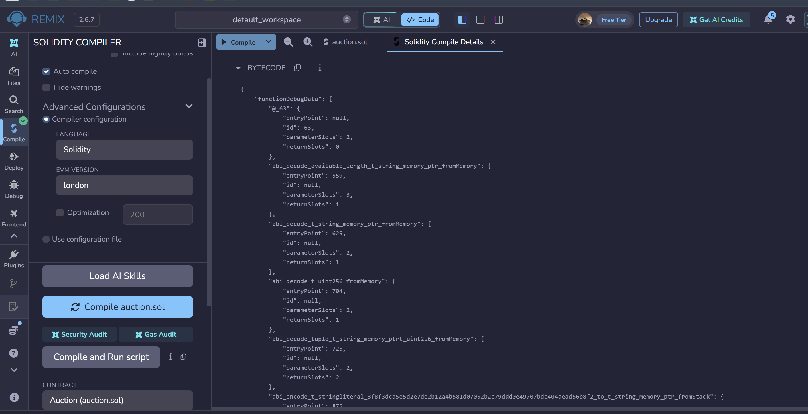

### 2. Smart contract deployment

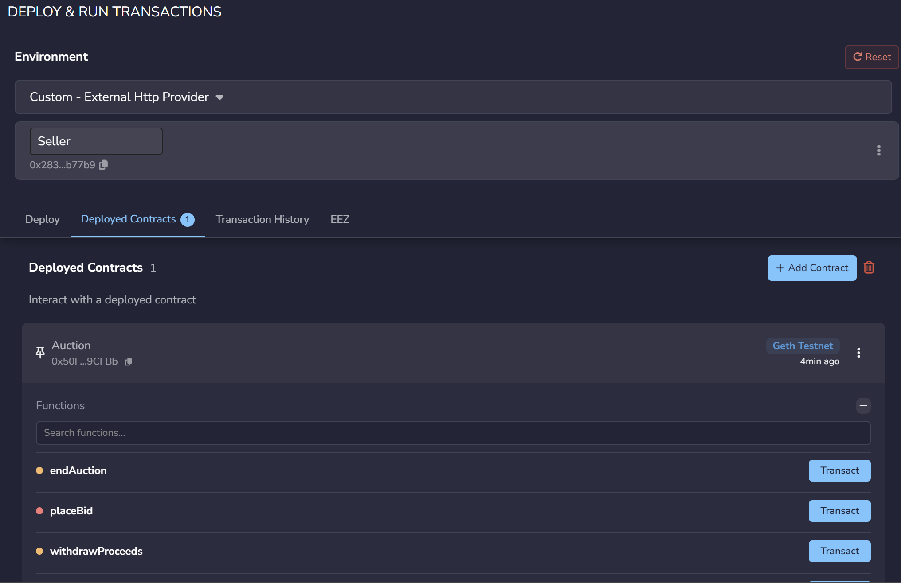

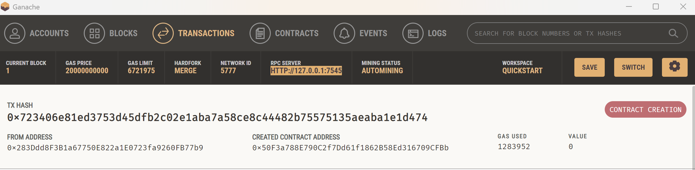

### 3. MetaMask wallet connection

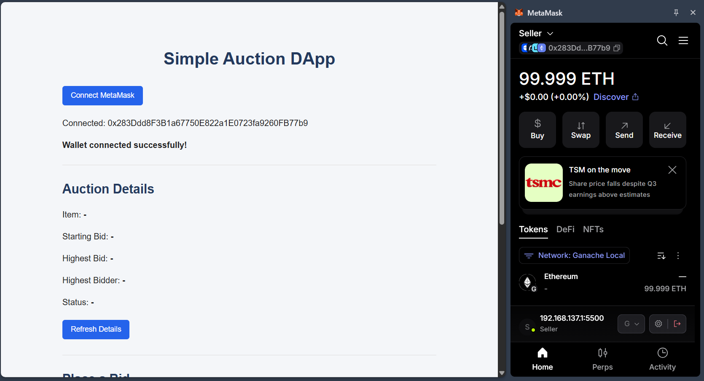

### 4. Successful transaction

Alice bids 2 ETH, Bob outbids her, Alice withdraws her refund, and the seller closes and settles the auction.

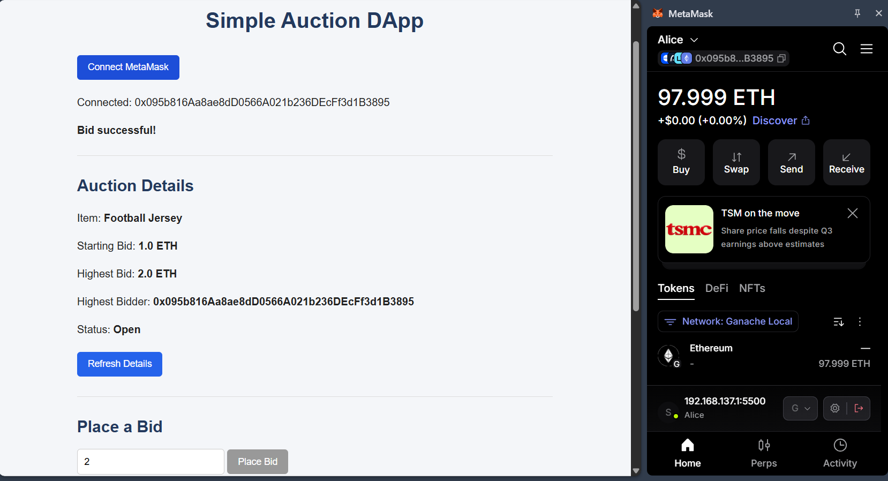

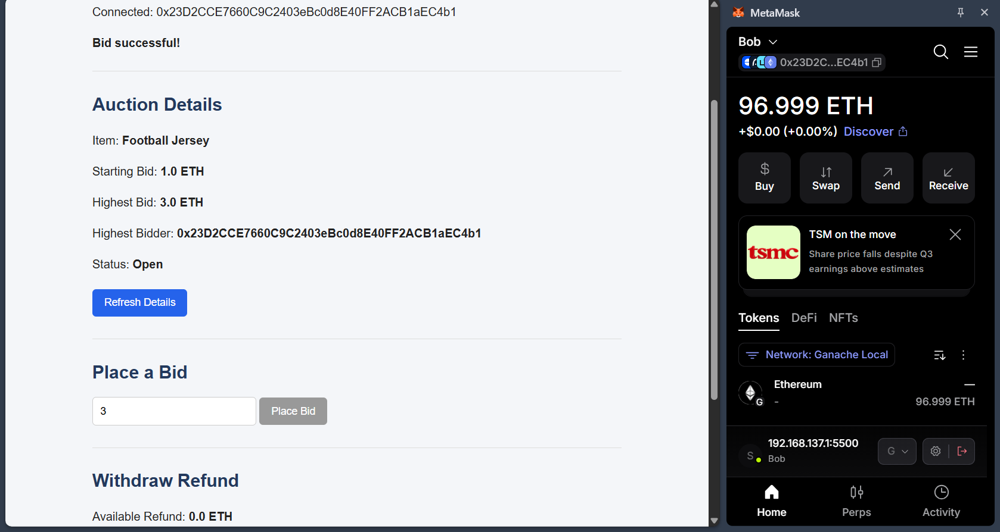

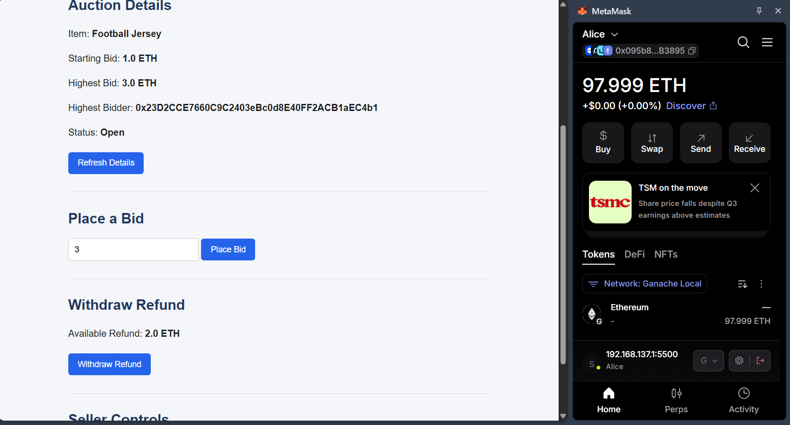

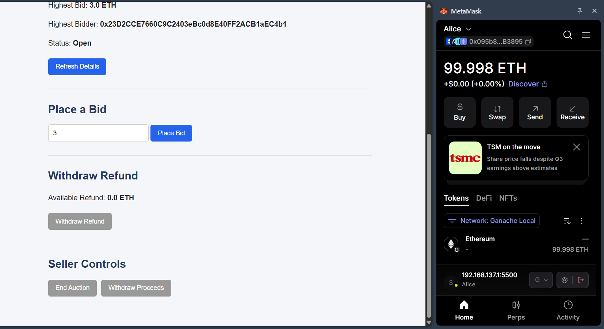

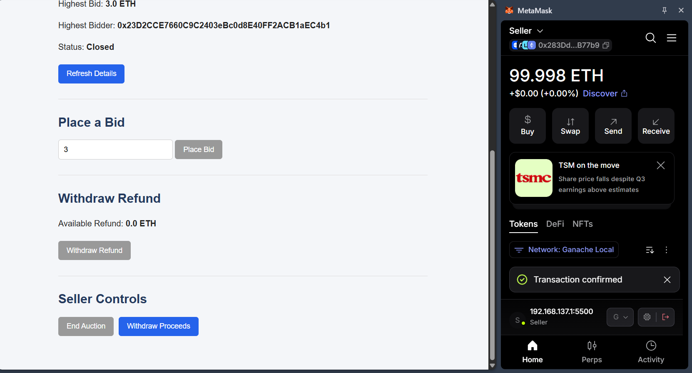

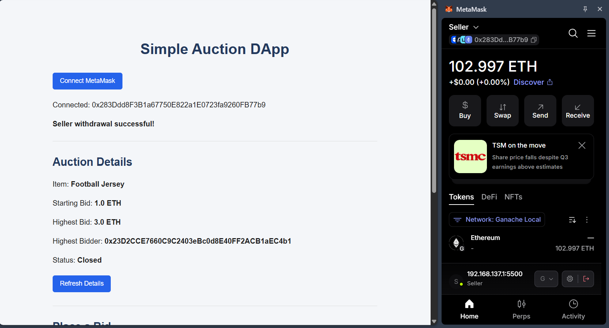

### 5. Failed transaction

These screenshots are from direct Remix VM tests and show the Solidity revert reasons.

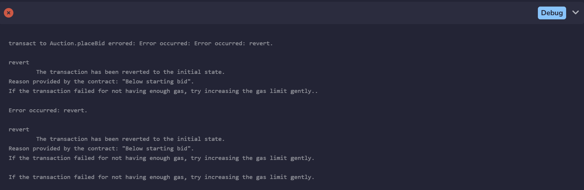

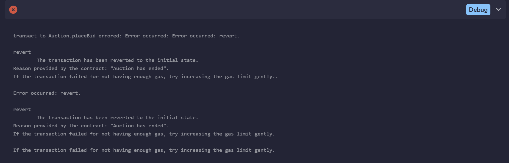

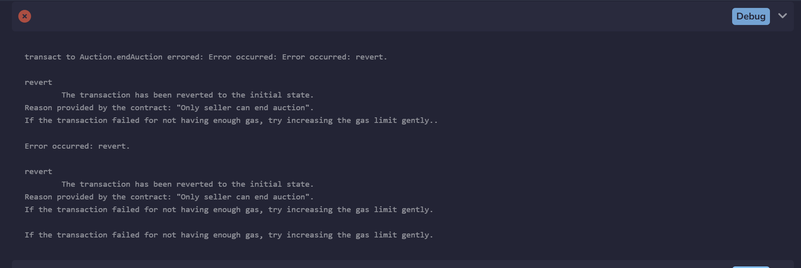

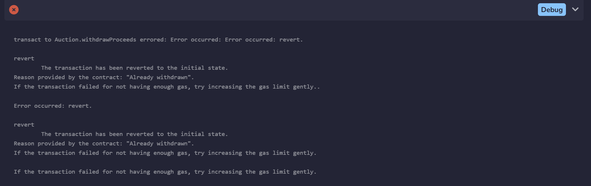

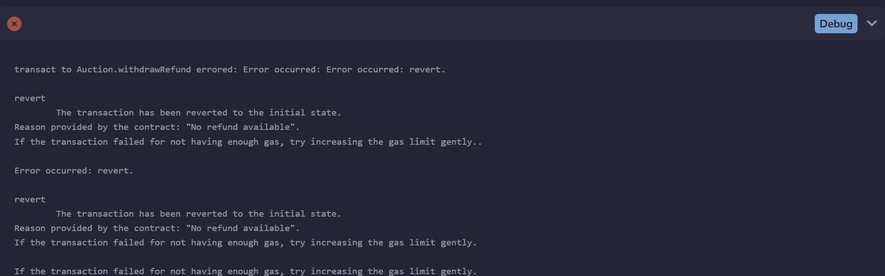

### 6. Blockchain data displayed through the UI

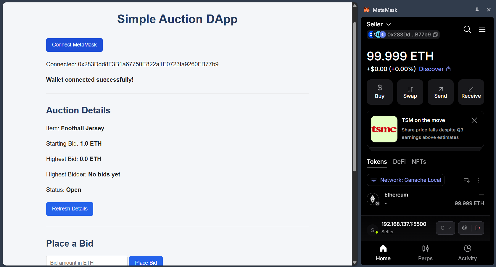
